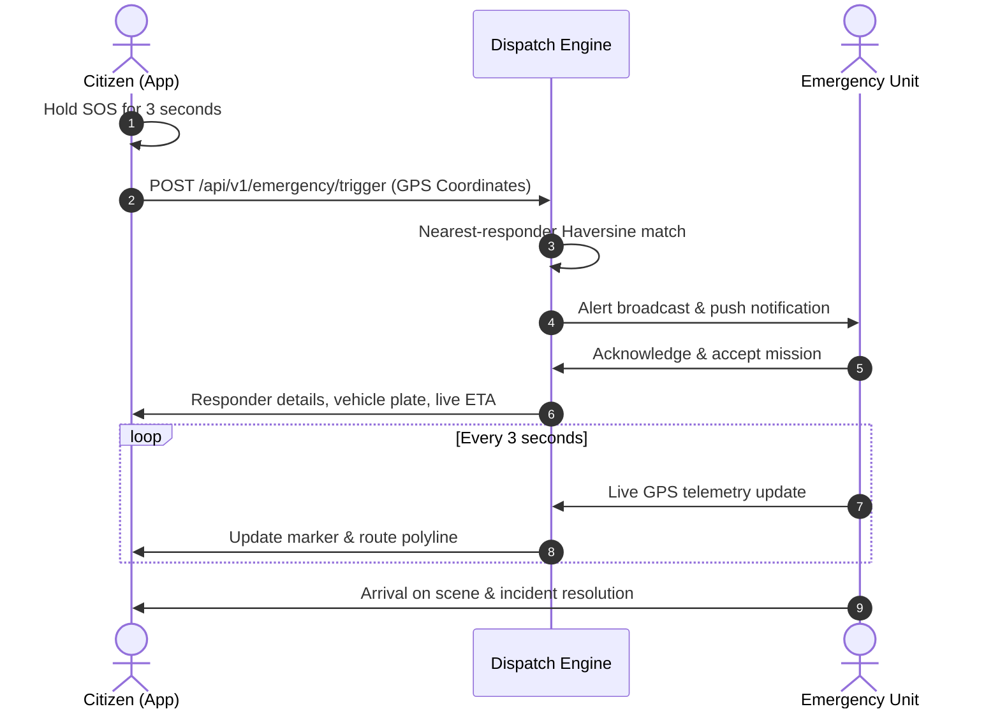

# SafeCall SOS - Emergency Resource Dispatch System 🚨

[](https://github.com/Meera2926/emergency-dispatch-system/actions)
[](https://opensource.org/licenses/MIT)
[](https://flutter.dev)
[](https://dart.dev)

A mission-critical Flutter mobile application designed to instantly connect citizens in distress with emergency first responders (medical, police, fire) via real-time GPS telemetry, nearest-neighbor dispatch heuristics, and interactive live tracking.

---

## 🌟 Key Features

- **🚨 SOS Hold-to-Trigger**: 3-second safety latch with CustomPainter glowing pulse ring to eliminate accidental triggers.
- **📍 Real-time Tracking & Telemetry**: Live map interface with Zomato/Uber-style delivery tracking, route polyline decoding, and ETA countdown.
- **⚡ Nearest Responder Dispatch Heuristic**: Automated allocation of nearest available ambulance, patrol car, or fire engine.
- **📴 Offline Resilience & SMS Fallback**: Queued telemetry sync and automated SMS dispatch with exact GPS coordinates when offline.
- **🌐 Multilingual Support**: Built-in support for English, Hindi (हिंदी), and Tamil (தமிழ்).
- **🔋 Battery-Aware GPS Throttling**: Dynamic location polling frequencies to conserve device power during long-duration emergencies.

---

## 📱 Architecture & Flow



---

## 🚀 Getting Started

```bash
# 1. Clone repository
git clone https://github.com/Meera2926/emergency-dispatch-system.git

# 2. Install packages
flutter pub get

# 3. Run test suites
flutter test

# 4. Launch application
flutter run
```

---

## 📚 Documentation
- [System Architecture](docs/ARCHITECTURE.md)
- [REST API Specification](docs/API_SPECIFICATION.md)
- [Dispatch Algorithm & Heuristics](docs/DISPATCH_ALGORITHM.md)
- [Setup & Configuration Guide](docs/SETUP_GUIDE.md)
- [Testing Strategy](docs/TESTING_STRATEGY.md)

---

## 📄 License
This project is licensed under the MIT License - see the [LICENSE](LICENSE) file for details.
