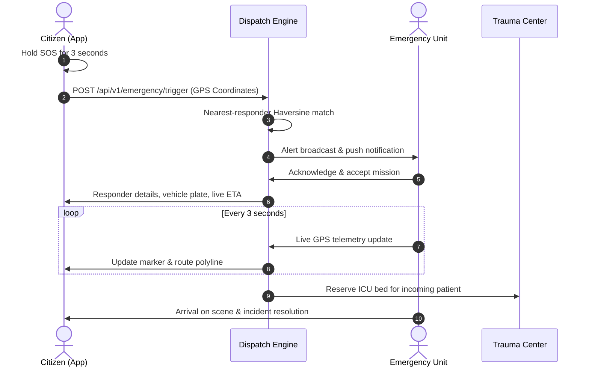

# SafeCall SOS - Emergency Resource Dispatch System 🚨

[](https://github.com/Meera2926/emergency-dispatch-system/actions)
[](CHANGELOG.md)
[](LICENSE)
[](https://flutter.dev)

A mission-critical Flutter mobile application designed to instantly connect citizens in distress with emergency first responders (medical, police, fire) via real-time GPS telemetry, nearest-neighbor dispatch heuristics, dynamic geofencing, and interactive live tracking.

---

## 🌟 Key Features

- **🚨 SOS Hold-to-Trigger**: 3-second safety latch with CustomPainter glowing pulse ring to eliminate accidental triggers.
- **📍 Real-time Tracking & Telemetry**: Live map interface with Zomato/Uber-style delivery tracking, route polyline decoding, and ETA countdown.
- **⚡ Nearest Responder Dispatch Heuristic**: Automated allocation of nearest available ambulance, patrol car, or fire engine.
- **🏥 Hospital Bed Capacity & Trauma Routing**: Dynamic hospital selector routing critical patients to nearest facility with available ICU beds.
- **🛑 Hazard Geofencing**: 2D ray-casting polygon boundary warnings around active wildfire, gas leak, and flood disaster perimeters.
- **🫀 First-Aid & 110 BPM CPR Metronome**: Interactive audio-visual chest compression pacer following AHA resuscitation guidelines.
- **📴 Offline Resilience & SMS Fallback**: Encrypted SQLite local cache, queued telemetry sync, and automated SMS dispatch with exact GPS coordinates.
- **🌐 Multilingual & Accessible**: Full English, Hindi (हिंदी), and Tamil (தமிழ்) localization, TalkBack semantics, and high-contrast dark theme.

---

## 📱 Architecture & Data Flow



---

## 🚀 Getting Started

```bash
# 1. Clone repository
git clone https://github.com/Meera2926/emergency-dispatch-system.git

# 2. Install packages
flutter pub get

# 3. Run test suites
flutter test

# 4. Launch application
flutter run
```

---

## 📚 Technical Documentation
- [System Architecture](docs/ARCHITECTURE.md)
- [REST API Specification](docs/API_SPECIFICATION.md)
- [Dispatch Algorithm & Heuristics](docs/DISPATCH_ALGORITHM.md)
- [Local Storage & SQLite Schema](docs/DATABASE_SCHEMA.md)
- [Geofencing & START Triage](docs/GEOFENCING_AND_TRIAGE.md)
- [Performance Benchmarks](docs/PERFORMANCE_BENCHMARKS.md)
- [Security Audit & Threat Model](docs/SECURITY_AUDIT.md)
- [Release Changelog](CHANGELOG.md)

---

## 📄 License
This project is licensed under the MIT License - see the [LICENSE](LICENSE) file for details.
