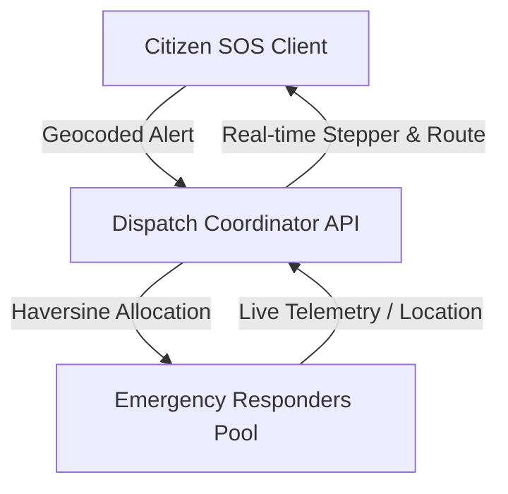

# Emergency Resource Dispatch System (ERDS) - System Architecture

## Overview
The Emergency Resource Dispatch System is a mission-critical mobile application built on Flutter that bridges citizens in distress with emergency first responders (medical, police, fire).

## Core Architectural Layers
1. **Presentation Layer**: SOS Trigger Ring, Status Banner, Help-On-The-Way Stepper, Live Map Tracking.
2. **Domain Layer**: Emergency and Responder entity models, state machines, severity weighting.
3. **Service Layer**: Dynamic location tracking, reverse geocoding cache, directions decoder, offline replay queue.
4. **State Management**: Reactive StateNotifiers for zero-lag state propagation.
