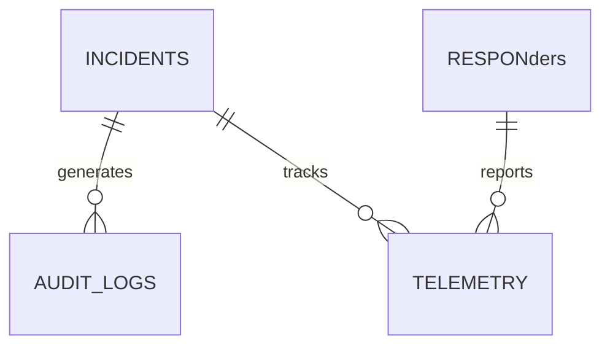

# ERDS Local Storage & Offline Database Architecture

## Overview
The application utilizes an encrypted local database to guarantee high reliability and offline persistence for emergency telemetry and incident logs.

### Table Specifications
1. **incidents**: stores emergency alerts with geolocation, triage status, and assigned unit ID.
2. **responders**: local cache of units within dynamic patrol sectors.
3. **telemetry_points**: high-frequency breadcrumbs recorded during active dispatches.
4. **sync_registry**: ledger of offline operations pending cloud acknowledgment.
